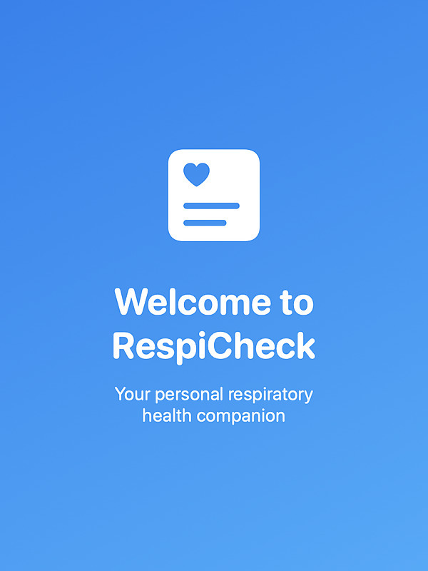
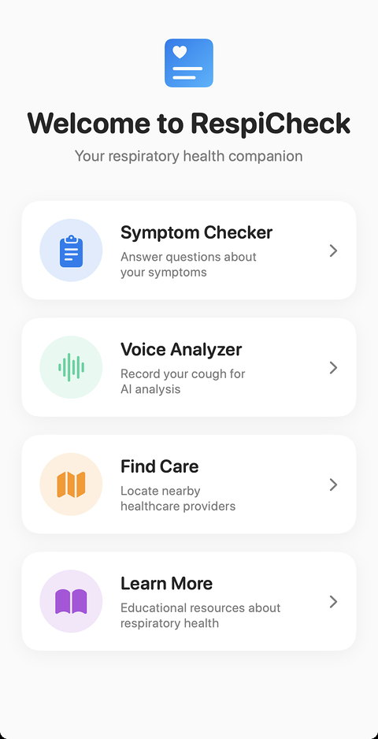
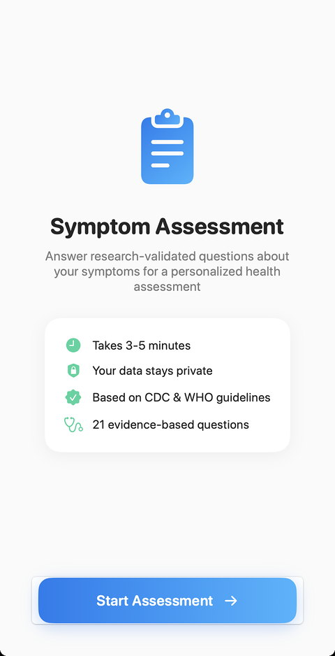
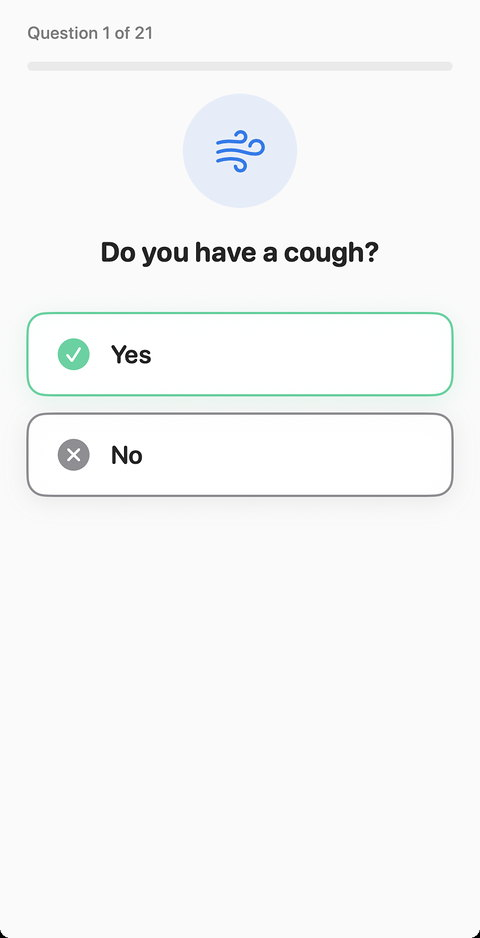
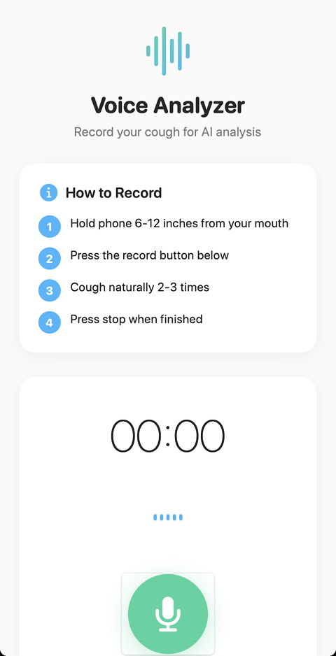
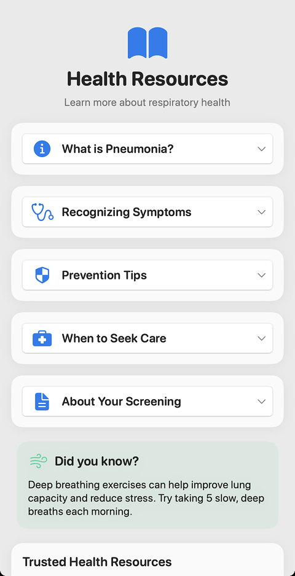
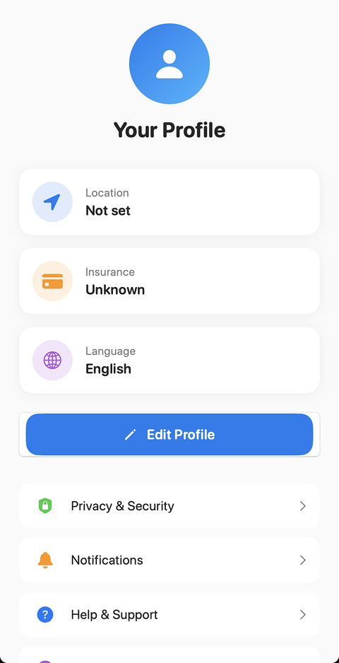

# RespiCheck

**The last mile to respiratory care.** An iPhone app that walks someone through a symptom check, records a cough, and helps them find nearby care in their language.

<p align="center">
  
</p>

RespiCheck is built for people who may not have an easy path to a clinic: a guided check they can do on their own phone, then a short list of providers matched to distance, insurance, and language. Health information stays on the device.

This is a screening and navigation aid. It does not diagnose pneumonia or replace a clinician.

## Screenshots

<p align="center">
  
  
  
</p>
<p align="center">
  
  
  
</p>

## What you can do

- Answer 21 symptom questions drawn from CDC, WHO, ATS, and IDSA guidance, including emergency warning signs.
- Record a cough on the phone, with playback and a chance to record again.
- See a low, moderate, or high risk summary and what to do next.
- Find nearby care on a map or in a list, filtered by insurance, language, and distance.
- Read short explainers on pneumonia, prevention, and when to seek care.
- Use the app in English, Spanish, or Mandarin, with VoiceOver labels, Dynamic Type, and large tap targets.

## How a screening runs

1. **Welcome.** Language and a short introduction.
2. **Profile.** Age, location, and insurance, stored only on the phone.
3. **Symptoms.** One question at a time. Emergency answers surface a prompt to get immediate care.
4. **Cough.** A recording through the microphone, kept locally and deleted when the user clears it.
5. **Result.** A risk level with next steps.
6. **Care.** Nearby providers, with call and directions.

The risk label in this repository is a **simulated result** used to demonstrate the flow. The cough is recorded for real. It is not sent to a diagnostic model, and it is not a medical device.

## Stack

| | |
|---|---|
| Language | Swift |
| UI | SwiftUI |
| Architecture | MVVM |
| Audio | AVFoundation |
| Location and maps | Core Location, MapKit |
| Minimum iOS | 18.5 |
| Xcode target | `PnScreener` (the product name on screen is RespiCheck) |

## Repository layout

```
PnScreener/                 Xcode project and app source
  PnScreener/
    Models/                 User, survey, audio, providers
    ViewModels/             Screen state
    Views/                  Onboarding, home, symptoms, recording, results, care, resources, profile
    Components/             Buttons, cards, recorder, provider rows
    Localization/           English, Spanish, and Chinese strings
docs/
  cover.jpg                 600×800 JPEG, 3:4, for the submission cover
  screenshots/              App screens
  QUICKSTART.md
  XCODE_SETUP.md
  SYMPTOM_ASSESSMENT_GUIDE.md
  NEW_UI_GUIDE.md
  PROJECT_SUMMARY.md
```

## Run it

1. Install Xcode and open `PnScreener/PnScreener.xcodeproj`.
2. Choose an iPhone simulator, or a device signed in with your team.
3. Run.

Microphone permission is requested on the recording screen. Location permission is requested when matching providers. More detail is in [docs/QUICKSTART.md](docs/QUICKSTART.md) and [docs/XCODE_SETUP.md](docs/XCODE_SETUP.md).

## Privacy

- Profile, answers, and the recording stay in on-device storage.
- The user can delete that data from Profile.
- The app explains microphone and location access before using them.

## More documentation

- [Symptom questions](docs/SYMPTOM_ASSESSMENT_GUIDE.md)
- [Interface notes](docs/NEW_UI_GUIDE.md)
- [Project summary](docs/PROJECT_SUMMARY.md)

## License

[MIT](LICENSE) © 2025 Krish Sharma
